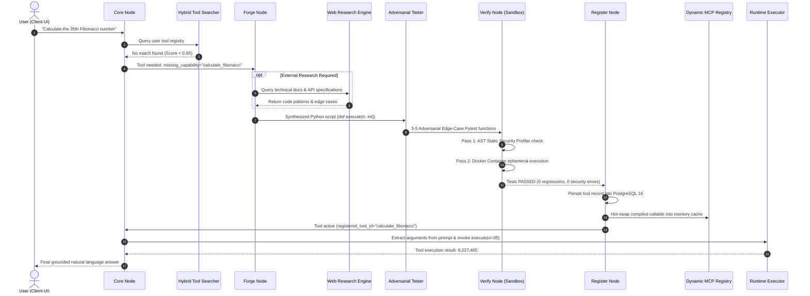
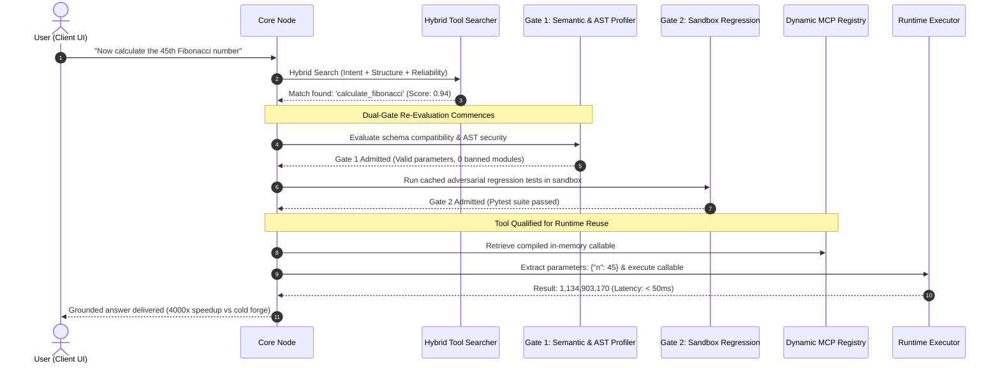
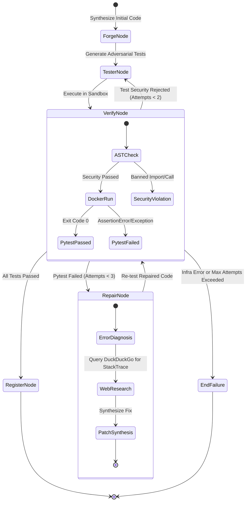

# 02. Architecture & System Design

## 1. High-Level System Architecture

The Self-Forging AI platform consists of six distinct, decoupled architectural tiers:
1. **Presentation Tier (React 19 + Vite)**: Glassmorphic, mobile-responsive SPA with real-time WebSocket telemetry.
2. **API & Orchestration Gateway (FastAPI)**: Async REST endpoints, JWT/OAuth authentication, and session handling.
3. **Agent State Machine (LangGraph)**: Cyclic multi-agent graph directing tool detection, code generation, testing, and self-repair.
4. **Isolated Execution Sandbox (Docker Engine)**: Ephemeral, unprivileged Linux containers enforcing resource limits and security boundaries.
5. **Persistence & Cache Tier (PostgreSQL 16 + In-Memory Registry)**: Multi-tenant relational storage with on-demand Python bytecode hot-swapping.
6. **Object Storage Tier (MinIO S3)**: Distributed S3-compatible storage for user attachments and zipped tool archives.

```
                           ┌─────────────────────────────────────────┐
                           │      Client Frontend (React 19 + Vite)  │
                           │  - Conversation Chat & Markdown Stream  │
                           │  - Real-Time WebSocket Activity Drawer   │
                           │  - Tool Registry & .sfatool Marketplace │
                           │  - Dynamic Model Selector (Haiku, etc.) │
                           └──────────────────┬──────────────────────┘
                                              │ HTTP / WS
                                              ▼
                           ┌─────────────────────────────────────────┐
                           │      FastAPI Backend Gateway (Port 8000)│
                           │  - JWT Dual-Token & OAuth2 Auth        │
                           │  - Multi-Tenant Row-Level Scoping      │
                           │  - Document Extractor (PDF/CSV/JSON)    │
                           │  - WebSocket Lifecycle Broadcaster      │
                           └──────────────────┬──────────────────────┘
                                              │
                      ┌───────────────────────┴────────────────────────┐
                      ▼                                                ▼
         ┌─────────────────────────┐                     ┌─────────────────────────┐
         │ LangGraph Agent Machine │                     │ Multi-Tenant Storage    │
         │ - Core Node (Router)    │                     │ - PostgreSQL 16 (Port 5432)
         │ - Forge Node (Codegen)  │                     │   (Tools, Users, Logs)  │
         │ - Tester Node (Pytest)  │                     │ - MinIO S3 (Port 9000)  │
         │ - Verify Node (Gate)    │                     │   (Documents, Archives) │
         │ - Repair Node (Fixer)   │                     └─────────────────────────┘
         │ - Register Node (MCP)   │
         │ - Runtime Exec (Runner) │
         └────────────┬────────────┘
                      │
         ┌────────────┴────────────┐
         ▼                         ▼
┌─────────────────────────┐  ┌─────────────────────────────────────────┐
│ Isolated Docker Sandbox │  │ External LLM Routing Mesh               │
│ - Base: sfa-sandbox     │  │ - OmniRoute Proxy Gateway (Port 20128)  │
│ - Strict AST Profiler   │  │ - Anthropic (Claude 3.5 Haiku / Sonnet) │
│ - 512MB RAM, 60s timeout│  │ - OpenAI (GPT-4o) / DeepSeek V3 / Groq  │
│ - Network: "none"       │  │ - Autonomous Web Research (DuckDuckGo)  │
└─────────────────────────┘  └─────────────────────────────────────────┘
```

---

## 2. End-to-End Execution Lifecycles

### 2.1 Cold Tool Synthesis Flow (New Capability Needed)
When the user submits a task requiring computational, algorithmic, or data transformations not present in the registry:



---

### 2.2 Fast-Path Tool Reuse Flow (Novel Dual-Gate Admission)
When the user subsequently requests an operation matching an existing tool (e.g., *"Now calculate the 45th Fibonacci number"*):



---

### 2.3 The Self-Repair Loop Flow
If the generated tool fails adversarial sandbox verification:



---

## 3. Component Deep Dive

### 3.1 Backend Gateway (FastAPI)
The backend gateway handles all incoming network traffic:
* **Stateless Token Verification**: Verifies JWT access tokens (15-minute lifespan) on every authenticated endpoint.
* **Database Session Scoping**: Uses SQLAlchemy 2.0 `async_sessionmaker` yielding isolated database transactions.
* **WebSocket Connection Hub**: Manages bidirectional real-time event distribution with per-connection output queues and timeout-guarded message broadcasts.
* **Safe Error Handling**: Converts internal domain exceptions into clean HTTP status codes (400, 401, 403, 404, 422) with machine-readable detail messages.

### 3.2 Dynamic In-Memory MCP Registry
Traditional Python applications require a process restart or complex `importlib.reload` mechanics to load newly written Python code. 
The Self-Forging AI platform implements a **Multi-Tenant In-Memory Dynamic Registry** (`registry/mcp_manager.py`):
1. **Isolated Namespaces**: Stored in a nested dictionary `_user_registries[user_id][tool_id]`.
2. **Safe Compilation**: Uses Python's `compile(code, f"<dynamic_{name}>", "exec")` within a restricted local namespace dictionary.
3. **Callable Extraction**: Extracts the top-level `execute` function and binds it as an asynchronous callable.
4. **On-Demand Rehydration**: If a worker process restarts, any active tool is lazily rehydrated from PostgreSQL on its very first invocation.

### 3.3 Docker Sandbox Security Barrier
The untrusted code execution environment runs inside Docker:
* **Pre-Cached Image (`sfa-sandbox:latest`)**: Pre-installs `pytest`, `pydantic`, `numpy`, `scipy`, and standard libraries, reducing test startup latency from 30s to under 500ms.
* **Ephemeral Workspaces**: Each test execution creates a unique temporary directory mounted into the container at `/workspace`.
* **Zero Network Access**: `network_mode="none"` guarantees that untrusted code cannot connect to the internet, open reverse shells, or exfiltrate environment variables.
* **Strict Cgroups Limits**: 512MB RAM cap prevents memory exhaustion; 60s hard timeout kills infinite loops or fork bombs.

---

## 4. Multi-Tenant Data Isolation Strategy

Data isolation is enforced at four distinct levels:
1. **Database Schema**: All sensitive tables (`tools`, `conversations`, `activity_logs`, `conversation_attachments`, `user_sessions`) enforce foreign keys with `ondelete="CASCADE"` tied to `users.id`.
2. **Route Dependency Injection**: Every protected FastAPI route injects `user: User = Depends(get_current_user)`. Queries unconditionally filter by `where(Model.user_id == user.id)`.
3. **In-Memory Cache Keying**: The dynamic MCP registry indexes all compiled functions under `user_id`. An attacker attempting to call `execute_tool(user_id="user_b", tool_id="tool_of_user_a")` triggers a tenant violation and is rejected.
4. **MinIO S3 Key Prefixing**: Uploaded files and tool archives are keyed as:
   `user-documents/{user_id}/{conversation_id}/{uuid}_{filename}`.
